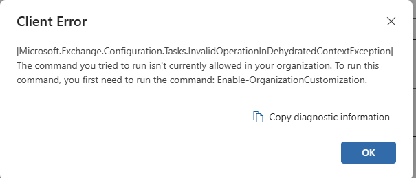

---

# **📘 Guide: Enabling Microsoft Purview Audit (Standard) in a Tenant**

This guide outlines the steps required to activate Microsoft Purview Audit (Standard) and ensure the audit pipeline is fully operational. These steps are necessary in tenants where audit logging has never been enabled or where Exchange Online remains in a “minimal configuration” state.

---

## **1. Enable Audit Logging in Purview**

1. Go to **Microsoft Purview → Audit**.
2. If prompted with **“Start recording user and admin activity”**, click the button.
3. If a dialog appears saying **“Complete organizational setup”**, choose **Yes**.
    - This initializes the tenant for Purview and compliance workloads.

**Expected behavior:**

- The banner disappears.
- The audit search interface becomes available.
- No audit events will appear yet — ingestion takes time.

---

## **2. Allow Time for Ingestion to Initialize**

After activation, the audit pipeline requires **5–30 minutes** to begin delivering events.

During this period, the UI may show:

- “Failed to load data”
- Empty search results
- No saved searches

This is normal for a first‑time activation.

---

## **3. (If Needed) Enable Exchange Online Organization Customization**

Some tenants require Exchange Online to be “hydrated” before Purview Audit can operate without backend errors.

If you receive this alert: 



Or,
If audit searches produce errors referencing:

- **InvalidOperationInDehydratedContextException**, or
- Instructions to run **Enable‑OrganizationCustomization**

…then complete the following steps.

### **3.1 Install the Exchange Online PowerShell Module**

Run PowerShell as Administrator:

```
Install-Module ExchangeOnlineManagement
```

Approve prompts to install the NuGet provider and trust PSGallery.

### **3.2 Allow Signed Scripts (if required)**

If PowerShell blocks the module from loading:

```
Set-ExecutionPolicy RemoteSigned -Scope CurrentUser
```

### **3.3 Connect to Exchange Online**

```
Connect-ExchangeOnline
```

Sign in with a Global Admin account.

### **3.4 Enable Organization Customization**

```
Enable-OrganizationCustomization
```

**Note:**  
If the tenant is already hydrated, Exchange will respond with:  
**“This operation is not required. Organization is already enabled for customization.”**  
This is normal and indicates no further action is needed.

---

## **4. Validate Audit Search Functionality**

Return to **Purview → Audit** and run a test search:

- Date range: **Last 24 hours**
- Activities: **List item updated** (or any common activity)
- Users: leave blank

**Success criteria:**

- The search runs without backend errors
- Results appear OR an empty result set is returned  
    (empty results are normal if no activity has occurred yet)

---

## **5. Expected Post‑Activation Behavior**

Once the pipeline is active:

- Audit events begin appearing automatically
- Saved searches load normally
- No setup banners or Exchange errors appear
- Purview Audit is fully operational

---

# **Summary**

This sequence ensures that:

- Purview Audit is enabled
- The tenant’s compliance backend is initialized
- Exchange Online is fully hydrated
- Audit searches run without errors
- Activity logs begin flowing normally

This is a one‑time setup for the lifetime of the tenant.

---

If you want, I can also prepare a **shorter “executive summary” version** or a **technician‑facing version** with more technical detail.